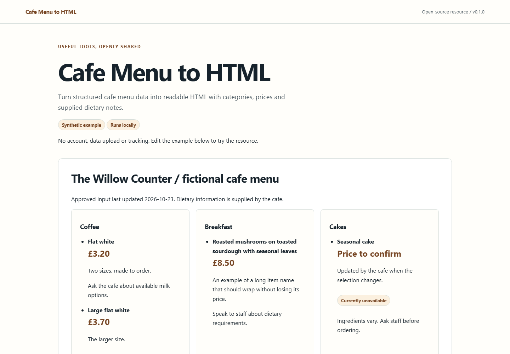

# Cafe Menu to HTML

Cafe Menu to HTML turns a simple menu file into a page customers can read on a phone. It keeps categories, descriptions and prices as text, with a printable layout and no account or hosted service to maintain.

Menu details and dietary statements come from the cafe's own approved records. The tool does not check food safety. Maintained by [Cafe Web Design](https://cafewebdesign.uk/), operated by JW Digital Services Ltd.



## Start locally

Requires Node.js 22 or later. No runtime dependencies or account required.

```sh
npm ci
npm test
npm run build
npm run serve
```

Open http://127.0.0.1:4173/ for the complete local demonstration. Browser examples do not upload or persist entered data. The optional development server binds to loopback only.

## Input and output

Supply cafe, updatedOn (YYYY-MM-DD), currency (GBP) and items with id, category, item, description, price, available and dietary_note. Prices are decimal strings; blank means confirm. Dietary notes are never inferred.

Use [examples/input.json](examples/input.json) as the complete input contract. Compare the generated [JSON result](examples/output.json), [Markdown report](examples/output.md) and [complete HTML](examples/output.html). The demo is in [demo/index.html](demo/index.html). It needs the local server for JavaScript modules. HTML reports can be opened as standalone files.

```sh
node cli.mjs examples/input.json --format json
node cli.mjs examples/input.json --format html --output report.html
node cli.mjs examples/input.json --format md --output report.md
```

Flat collections can also be imported with `--csv data.csv --context context.json --key items` (replace `items` with the documented collection). Nested structures use JSON. See `node cli.mjs --help`.

## Worked example

Use a fictional cafe with coffee, breakfast and cakes. Include two sizes of one drink, a long item description, a seasonal item marked unavailable, a zero-price fixture used only in tests, and a supplied note asking customers to speak to staff about dietary requirements. The output is a complete styled menu page, not an empty component gallery.

All supplied example records are synthetic. No clients, outcomes, current professional advice or real service availability are represented by them. Keep real records private and review output before sharing it.

## Checks

- Currency, decimal prices, blank prices and explicitly free items remain distinct.
- Item names and descriptions wrap at 320 px and large text settings; print output does not truncate prices.
- Categories have a sensible heading hierarchy. All content is present without JavaScript.
- Quoted CSV, Unicode and HTML-like input are handled safely. Dietary notes are never inferred or substituted.
- Changing one item and rebuilding updates the page and preserves unrelated categories.

The automated results and browser checks performed for this release are recorded in [verification.md](docs/verification.md). Manual screen-reader testing has not been performed. A passing automated check is not accessibility certification.

## Contribute and maintain

Use [Issues](https://github.com/Cafe-Web-Design/cafe-menu-to-html/issues) for a reproducible bug and [Discussions](https://github.com/Cafe-Web-Design/cafe-menu-to-html/discussions) for questions and improvements. Follow [CONTRIBUTING.md](CONTRIBUTING.md); report vulnerabilities privately using [SECURITY.md](SECURITY.md). See [CHANGELOG.md](CHANGELOG.md) for releases. Maintenance is best effort.

Code, original illustrations and synthetic fixtures are MIT licensed. There is no required website backlink when reusing the resource. Commercial brand assets and third-party material are not included.

## CSV example

```sh
node cli.mjs --csv examples/input.csv --context examples/context.json --key items --format html --output csv-report.html
```

The context holds the root settings; the CSV holds the flat collection. Explicit booleans use `true` or `false`. Nested data uses JSON.
